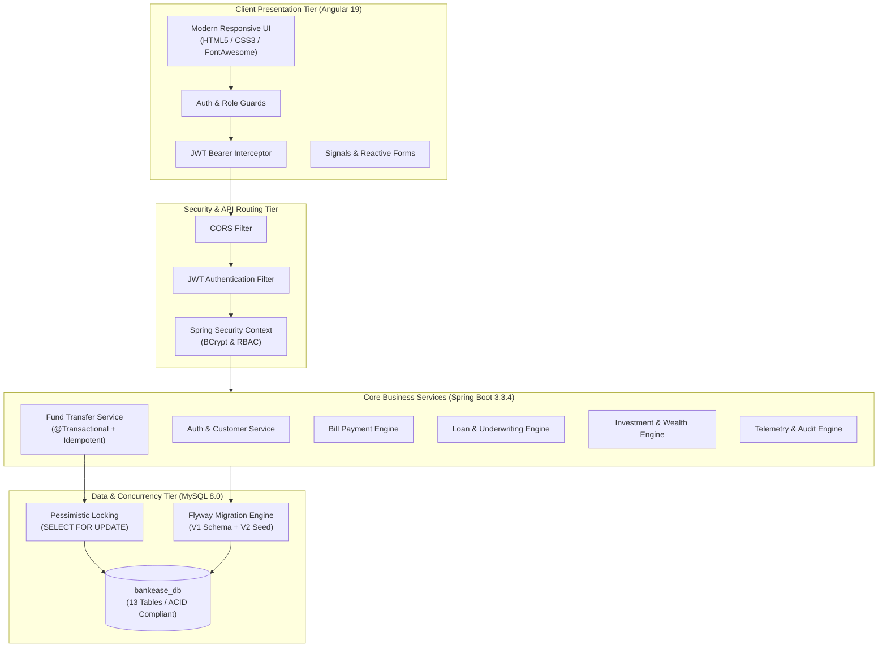

# BankEase – NextGen Net Banking 🏦

[](https://openjdk.org/)
[](https://spring.io/projects/spring-boot)
[](https://angular.dev/)
[](https://www.mysql.com/)
[](https://www.docker.com/)
[](https://opensource.org/licenses/MIT)

> **BankEase** is an enterprise-grade academic simulation of a modern digital banking platform built with Spring Boot 3, Angular 19, and MySQL. It delivers secure role-based access control, atomic fund transfers with pessimistic locking and simulated OTP verification, comprehensive loan and wealth management, bill payments, and administration telemetry.

---

## 📑 Table of Contents

1. [System Architecture](#-system-architecture)
2. [Technology Stack](#-technology-stack)
3. [Core Banking Modules](#-core-banking-modules)
4. [Database Design & Schema](#-database-design--schema)
5. [Security & Concurrency Guarantees](#-security--concurrency-guarantees)
6. [Demo Access Credentials](#-demo-access-credentials)
7. [Installation & Local Setup](#-installation--local-setup)
8. [Docker Deployment](#-docker-deployment)
9. [Automated Testing & Verification](#-automated-testing--verification)
10. [REST API Documentation](#-rest-api-documentation)
11. [Cloud Deployment Guide](#-cloud-deployment-guide)
12. [Repository Structure](#-repository-structure)
13. [License](#-license)

---

## 🏛️ System Architecture



---

## 💻 Technology Stack

| Layer | Technology | Version | Purpose |
|---|---|---|---|
| **Frontend** | Angular | 19.x / 22.x | High-performance single page application framework |
| | TypeScript | 5.5+ | Strictly-typed frontend development |
| | Angular Signals & Reactive Forms | Built-in | Ultra-fast reactivity and form validation |
| | CSS3 Banking Theme | Custom | Custom design system with CSS tokens and responsive grid |
| **Backend** | Java OpenJDK | 21 LTS | High-throughput runtime with virtual threads support |
| | Spring Boot | 3.3.4 | Modern RESTful enterprise backend framework |
| | Spring Security | 6.3.3 | Role-based authorization and stateless JWT authentication |
| | Spring Data JPA / Hibernate | 6.5+ | Object-relational mapping and pessimistic row-level locking |
| | Flyway Migration | 10.11+ | Automated version-controlled database schema migrations |
| | Maven | 3.9+ | Dependency management and build packaging |
| **Database** | MySQL Server | 8.0+ | Relational data persistence with strict foreign key constraints |
| | H2 Database | 2.2+ | In-memory zero-configuration testing harness |
| **DevOps & Containers** | Docker & Docker Compose | 3.8+ | Multi-stage isolated container orchestration |
| | GitHub Actions | CI/CD | Automated building, testing, and linting |

---

## 🧩 Core Banking Modules

### 1. Authentication & Security
- Customer self-registration with automatic savings account creation.
- Stateless authentication using signed JSON Web Tokens (JJWT 0.12.6).
- BCrypt salted hashing (`10` rounds) for credential protection.
- Role-based access control with granular roles: `CUSTOMER`, `BANK_STAFF`, `ADMIN`.
- User profile viewer and secure password update with old password verification.

### 2. Account Management
- Comprehensive multi-account support (`SAVINGS`, `CURRENT`, `SALARY`).
- Real-time balance enquiry with full decimal accuracy (`BigDecimal` with 2 decimal places).
- Account status lifecycle: `ACTIVE`, `FROZEN`, `CLOSED`.
- Statement generation and tabular transaction drilldowns.

### 3. Beneficiary Management
- Add trusted intra-bank and inter-bank payees with IFSC and account validation.
- Instant beneficiary listing, editing, deletion, and quick-transfer links.

### 4. Fund Transfer (Atomic & Idempotent)
- High-concurrency fund transfers using database row-level locking (`PESSIMISTIC_WRITE`).
- Atomic debit and credit operations within `@Transactional` boundaries.
- Simulated Two-Factor Authentication (OTP verification flow).
- Custom `Idempotency-Key` tracking preventing double-spending on network retries.
- Instant downloadable transaction voucher receipt.

### 5. Transaction History & Filtering
- Searchable and paginated transaction ledger.
- Filter by transaction type (`TRANSFER`, `BILL_PAYMENT`, `DEPOSIT`, `WITHDRAWAL`).
- Filter by status (`SUCCESS`, `PENDING`, `FAILED`) and date range.

### 6. Utility Bill Payments
- Simulated utility clearinghouse for 5 major categories: Electricity, Water, Mobile Recharge, Gas, Internet.
- Real-time balance debit and automated invoice confirmation receipt.

### 7. Loan Management & Underwriting
- Multiple loan products: Home Loan (8.5%), Personal Loan (11.5%), Education Loan (9.0%), Vehicle Loan (8.9%).
- Interactive client-side EMI calculator.
- Digital loan application submission and status tracking (`SUBMITTED`, `UNDER_REVIEW`, `APPROVED`, `REJECTED`).
- Bank staff review queue with underwriting approval/rejection and remarks.

### 8. Wealth & Investment Services
- Investment portfolio products: Fixed Deposit (7.25%), Recurring Deposit (6.8%), Mutual Funds (12.5%), National Pension Scheme (9.8%).
- Interactive compound interest ROI calculator.
- Requisition submission, staff review, and active portfolio ledger.

### 9. Notifications & Administration
- Real-time alert feed tracking fund transfers, bill receipts, loan decisions, and security alerts.
- Unread badge counter with 1-click "Mark All as Read".
- Administrative dashboard with real-time telemetry (total users, deposits, loans, transactions).
- User activation toggles, account freeze/unfreeze controls, and immutable security audit logs.

---

## 🗄️ Database Design & Schema

The relational schema comprises **13 normalized tables** configured in `bankease_db`:

```
bankease_db
├── customers           # KYC identity records, PAN, address, contact
├── users               # Authentication credentials, BCrypt hashes, active flag
├── roles               # Role definitions (CUSTOMER, BANK_STAFF, ADMIN)
├── user_roles          # Many-to-Many role mapping
├── accounts            # Account number, account type, balance, status
├── beneficiaries       # Payee directory per customer
├── transactions        # Double-entry ledger (DEBIT / CREDIT)
├── transfers           # Atomic transfer records with reference numbers
├── bill_payments       # Utility clearing records, biller names, consumer IDs
├── loans               # Loan applications, interest rates, tenures, EMI, review notes
├── investments         # Wealth portfolios, maturity rates, durations
├── notifications       # Notification inbox with read/unread tracking
├── otp_verifications   # Simulated OTP verification codes with expiry
├── audit_logs          # Immutable security and access event logs
└── idempotency_records # Unique request keys to prevent duplicate transactions
```

---

## 🔐 Security & Concurrency Guarantees

1. **Atomic Fund Transfers:** Debit of sender and credit of recipient execute within an atomic Spring `@Transactional(isolation = Isolation.READ_COMMITTED)` boundary. If either leg fails, the entire transaction rolls back cleanly.
2. **Pessimistic Row-Level Locking:** Account rows are locked via `SELECT ... FOR UPDATE` (`LockModeType.PESSIMISTIC_WRITE`) to eliminate race conditions, phantom reads, and lost updates during concurrent transfers.
3. **Idempotency Protection:** Endpoints accept an `Idempotency-Key` HTTP header. Repeated requests return the original cached response without re-executing balances.
4. **Simulated OTP Verification:** Financial operations require a 6-digit OTP verification token, simulating high-assurance banking 2FA.
5. **No Floating Point for Money:** All currency amounts use `java.math.BigDecimal` (mapped to MySQL `DECIMAL(15,2)`), completely eliminating binary floating-point rounding errors.

---

## 👥 Demo Access Credentials

| Role | Username | Password | Purpose |
|---|---|---|---|
| **Customer** | `rajesh` | `Password@123` | Complete net banking customer experience |
| **Bank Staff** | `staff` | `Password@123` | Review & underwrite loans, approve investments |
| **Administrator** | `admin` | `Admin@123` | System telemetry, freeze accounts, user control, audit logs |

---

## 🚀 Installation & Local Setup

### 1. Prerequisites
- **Java OpenJDK 21 LTS**
- **Node.js 18.x or 20.x+** & npm
- **MySQL 8.0+**
- **Apache Maven 3.9+** (or use included tools)

### 2. Database Initialization
```bash
# Log in to MySQL
mysql -u root -p

# Create database and user
CREATE DATABASE bankease_db;
CREATE USER 'bankease'@'localhost' IDENTIFIED BY 'Password@123';
GRANT ALL PRIVILEGES ON bankease_db.* TO 'bankease'@'localhost';
FLUSH PRIVILEGES;

# Run schema and seed scripts
mysql -u bankease -p bankease_db < Database/schema.sql
mysql -u bankease -p bankease_db < Database/sample-data.sql
```

### 3. Backend Startup
```bash
cd BankEase-Backend

# Run automated tests
mvn test

# Start the Spring Boot server
mvn spring-boot:run
```
*The backend API will start on `http://localhost:8080/api`.*

### 4. Frontend Startup
```bash
cd BankEase-Frontend

# Install dependencies
npm install

# Start Angular development server
npm start
```
*The web application will open on `http://localhost:4200`.*

---

## 🐳 Docker Deployment

To spin up the entire application stack (MySQL + Spring Boot Backend + Angular Nginx Frontend) with a single command:

```bash
docker-compose up --build -d
```

### Access Containers
- **Frontend Web UI:** `http://localhost` (Port 80)
- **Backend API:** `http://localhost:8080/api`
- **MySQL Database:** `localhost:3306`

To shut down:
```bash
docker-compose down -v
```

---

## 🧪 Automated Testing & Verification

Both frontend and backend include comprehensive test suites and strict type validation:

### Backend Tests
```bash
cd BankEase-Backend
mvn test
```
- `BankEaseApplicationTests`: Spring Boot context loading test.
- `AuthServiceTest`: Registration, duplicate username rejection, BCrypt hashing, and JWT issuance tests.
- `FundTransferServiceTest`: Atomic transfer, insufficient balance rejection, and balance integrity verification.

**Result:** `Tests run: 5, Failures: 0, Errors: 0, Skipped: 0` (BUILD SUCCESS).

### Frontend Build Verification
```bash
cd BankEase-Frontend
npm run build
```
- Full Angular Ahead-of-Time (AOT) compilation.
- TypeScript strict mode verification.
- Output chunk bundles generated in `dist/BankEase-Frontend/browser`.

---

## 📡 REST API Documentation

| Module | Method | Endpoint | Description | Role Required |
|---|---|---|---|---|
| **Auth** | `POST` | `/api/auth/register` | Register new customer & open savings account | `PUBLIC` |
| | `POST` | `/api/auth/login` | Authenticate user & issue JWT token | `PUBLIC` |
| | `GET` | `/api/auth/me` | Fetch active user profile | `ANY` |
| | `POST` | `/api/auth/change-password` | Update account password | `ANY` |
| **Accounts** | `GET` | `/api/accounts/my` | List current customer's accounts | `CUSTOMER` |
| | `GET` | `/api/accounts/{id}` | Get account details by ID | `CUSTOMER` |
| | `GET` | `/api/accounts/overview` | Dashboard summary metrics & recent txns | `CUSTOMER` |
| **Beneficiaries** | `GET` | `/api/beneficiaries` | List saved beneficiaries | `CUSTOMER` |
| | `POST` | `/api/beneficiaries` | Add new beneficiary | `CUSTOMER` |
| | `DELETE` | `/api/beneficiaries/{id}` | Delete beneficiary | `CUSTOMER` |
| **Transfers** | `POST` | `/api/transfers/send-otp` | Request simulated 2FA OTP | `CUSTOMER` |
| | `POST` | `/api/transfers` | Execute atomic fund transfer (Idempotent) | `CUSTOMER` |
| | `GET` | `/api/transfers/my` | View transfer history | `CUSTOMER` |
| **Transactions** | `GET` | `/api/transactions/my` | Search and filter transactions ledger | `CUSTOMER` |
| | `GET` | `/api/transactions/{id}` | View transaction receipt voucher | `CUSTOMER` |
| **Bills** | `POST` | `/api/bills/pay` | Pay utility bill (Electricity, Water, etc.) | `CUSTOMER` |
| | `GET` | `/api/bills/my` | View bill payment history | `CUSTOMER` |
| **Loans** | `GET` | `/api/loans/types` | List available loan products | `CUSTOMER` |
| | `POST` | `/api/loans/apply` | Submit digital loan application | `CUSTOMER` |
| | `GET` | `/api/loans` | View customer loan applications | `CUSTOMER` |
| **Investments** | `GET` | `/api/investments/plans` | List wealth investment plans | `CUSTOMER` |
| | `POST` | `/api/investments` | Submit investment requisition | `CUSTOMER` |
| | `GET` | `/api/investments` | View customer investments portfolio | `CUSTOMER` |
| **Notifications** | `GET` | `/api/notifications` | View notification inbox | `CUSTOMER` |
| | `PATCH` | `/api/notifications/{id}/read`| Mark single notification as read | `CUSTOMER` |
| | `PATCH` | `/api/notifications/read-all` | Mark all notifications as read | `CUSTOMER` |
| **Staff** | `GET` | `/api/staff/loans` | View pending loan underwriting queue | `BANK_STAFF`, `ADMIN` |
| | `PATCH` | `/api/staff/loans/{id}/status`| Approve or reject loan application | `BANK_STAFF`, `ADMIN` |
| | `GET` | `/api/staff/investments` | View investment requisitions queue | `BANK_STAFF`, `ADMIN` |
| | `PATCH` | `/api/staff/investments/{id}/status`| Approve or cancel investment | `BANK_STAFF`, `ADMIN` |
| **Admin** | `GET` | `/api/admin/metrics` | System KPIs & core deposits volume | `ADMIN` |
| | `GET` | `/api/admin/users` | List all system users | `ADMIN` |
| | `PATCH` | `/api/admin/users/{id}/toggle` | Enable or disable user access | `ADMIN` |
| | `GET` | `/api/admin/accounts` | Core accounts ledger | `ADMIN` |
| | `PATCH` | `/api/admin/accounts/{id}/status`| Freeze, unfreeze, or close account | `ADMIN` |
| | `GET` | `/api/admin/audit-logs` | Immutable security audit logs | `ADMIN` |
| | `POST` | `/api/admin/staff` | Provision new bank staff account | `ADMIN` |

---

## ☁️ Cloud Deployment Guide

### Deploying to Render
1. Push this repository to GitHub.
2. In the Render Dashboard, click **New > Blueprint**.
3. Select your repository `BankEase-NextGen-Net-Banking`.
4. Render will read `render.yaml` and provision:
   - MySQL Database (`bankease_db`)
   - Backend Web Service (Docker container)
   - Frontend Static Site (Angular SPA)
5. Set environment variable `CORS_ALLOWED_ORIGINS` on the backend service to match your frontend Render URL.

### Deploying Frontend to Vercel or Netlify
- The frontend includes `BankEase-Frontend/vercel.json` and `BankEase-Frontend/public/_redirects` to handle Single Page Application routing redirects.
- In Vercel or Netlify, set root directory to `BankEase-Frontend`, build command to `npm run build`, and publish directory to `dist/BankEase-Frontend/browser`.

---

## 📂 Repository Structure

```
BankEase-NextGen-Net-Banking/
├── .github/
│   └── workflows/
│       └── ci-cd.yml                # GitHub Actions automated build & test pipeline
├── BankEase-Backend/
│   ├── src/
│   │   ├── main/java/com/bankease/  # Controllers, Services, Entities, Repositories, Security
│   │   ├── main/resources/          # application.properties, Flyway migrations V1 & V2
│   │   └── test/java/               # Unit and Integration test suites
│   ├── Dockerfile                   # Multi-stage JDK 21 Alpine container build
│   └── pom.xml                      # Maven project configuration
├── BankEase-Frontend/
│   ├── src/
│   │   ├── app/                     # 16 Standalone components, models, guards, interceptors
│   │   ├── environments/            # Dev & Prod API URL configurations
│   │   └── styles.css               # Design system tokens and styles
│   ├── Dockerfile                   # Multi-stage Node + Nginx Alpine build
│   ├── nginx.conf                   # Production Nginx SPA reverse-proxy configuration
│   ├── vercel.json                  # Vercel SPA routing configuration
│   └── package.json                 # Angular dependencies and build scripts
├── Database/
│   ├── schema.sql                   # Complete DDL script (13 tables, keys, constraints)
│   ├── sample-data.sql              # Fictional seed data for testing
│   └── README.md                    # Database documentation
├── Documentation/
│   ├── Architecture.md              # System architecture & component interaction
│   ├── Database-Design.md           # ER diagram, tables dictionary & indexing
│   └── API-Documentation.md         # Comprehensive REST API catalog
├── .gitignore                       # Clean repository exclusions
├── docker-compose.yml               # Multi-container orchestration (MySQL + Backend + Frontend)
├── LICENSE                          # MIT License
├── README.md                        # Master documentation
└── render.yaml                      # Render Infrastructure as Code Blueprint
```

---

## 📄 License

This project is licensed under the MIT License - see the [LICENSE](LICENSE) file for details.

Developed by **Ayush Sharma** ([@AyushSharma-13](https://github.com/AyushSharma-13)).

